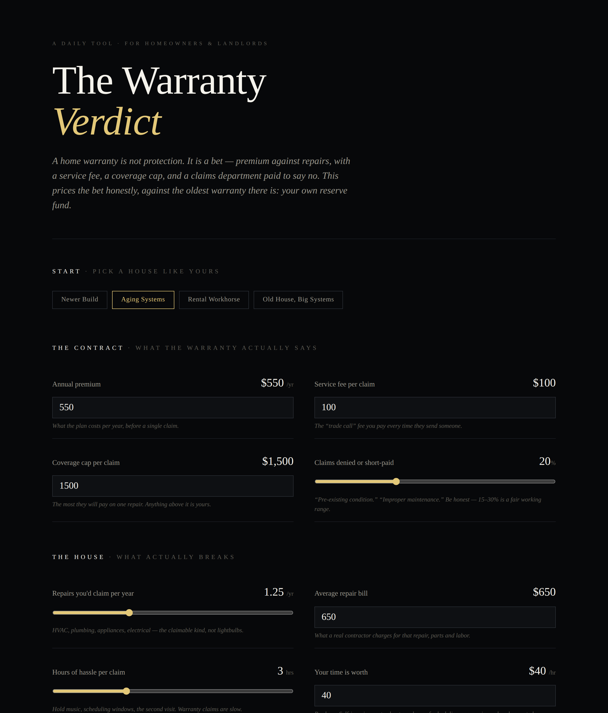

# The Warranty Verdict

**Live:** https://thebullbrew.github.io/warranty-verdict/

## What it does

A home warranty is not protection — it's a bet: premium against repairs, with a service fee on every claim, a per-claim coverage cap, and a claims department with every incentive to say no. The Warranty Verdict prices that bet honestly against the oldest warranty there is: your own reserve fund.

Enter the premium, service fee, coverage cap, and a realistic denial rate, plus how often things actually break in your house and what repairs really cost. The tool returns a wax-seal verdict — **BUY IT / SELF-INSURE / CLOSE CALL / PAPER SHIELD** — with the full-hold totals for both paths, break-even claims per year, the break-even premium at which the plan would be a fair bet, how many cents the company pays back per premium dollar, a money-anatomy bar showing where the warranty dollars actually go, itemized per-year ledgers for both paths, claims and denial sensitivity tables, four presets (Newer Build, Aging Systems, Rental Workhorse, Old House Big Systems), saveable cases, and a copyable summary.

## The method

Every claim has three outcomes, and the brochure only mentions one. Approved: you pay the service fee plus anything above the cap. Denied or short-paid: the full contractor bill lands on you, after weeks of waiting. Either way you pay in hours — their contractor works on their schedule. The tool prices all three across the whole hold and compares it with keeping the premium, funding a reserve, and hiring your own contractor in one phone call (self-insuring still costs an hour of scheduling per repair, and that is counted too). Denial rates of 35% or more trigger the PAPER SHIELD seal regardless of the totals — a contract that says no a third of the time is paperwork, not insurance.

## How to run

Open `docs/index.html` in any browser — it's a single self-contained page, works offline as a PWA, and stores saved cases only in your browser's local storage. No backend, no accounts, no data leaves the page.

Design: dark old-money variation 13 — Obsidian Club (near-black minimalism, platinum-gold used sparingly, huge serif type).
